# B-Ring

Self-hosted hybrid file space: Android devices (**Moons**) orbit a Linux
workstation (**Ring**) that keeps plain files on disk as the single source of
truth.

- Design: [`docs/ARCHITECTURE.md`](docs/ARCHITECTURE.md)
- Android / Wi-Fi ADB cheatsheet: [`docs/ANDROID_DEV.md`](docs/ANDROID_DEV.md)
- Workspace: `crates/bring-core`, `crates/bringd`, `crates/bring-cli` (`bring`),
  `crates/bring-uniffi`; Android client in `android/`.

## Screenshots

UI built with [The Mechanics](https://github.com/hipotures/the-mechanics) in **Light**, **Dark**, and **Coffee** themes:

<table>
  <tr>
    <td align="center">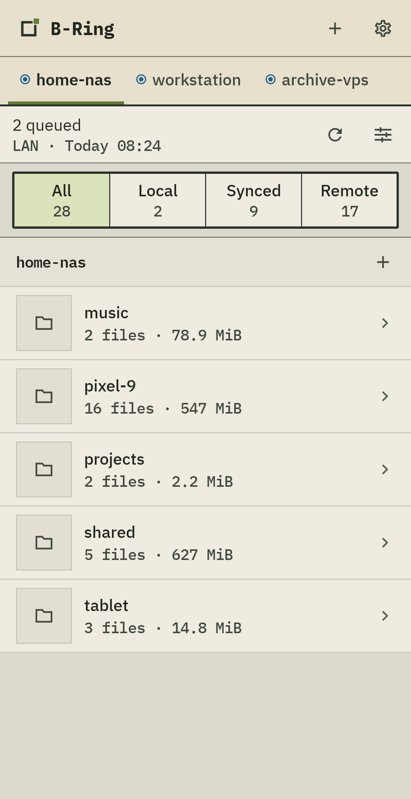<br /><sub>Home · Light</sub></td>
    <td align="center">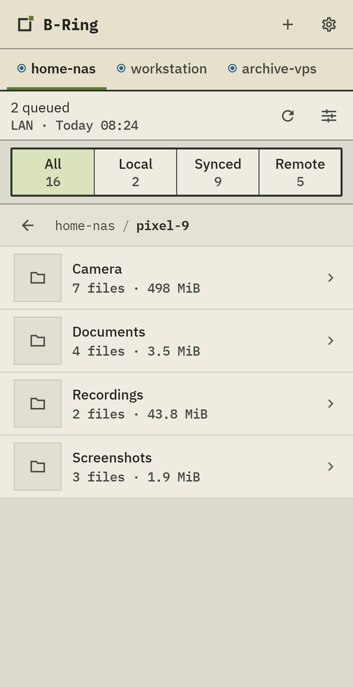<br /><sub>Folders · Light</sub></td>
    <td align="center">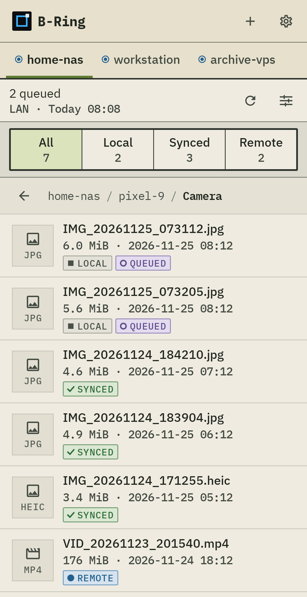<br /><sub>Files · Light</sub></td>
    <td align="center">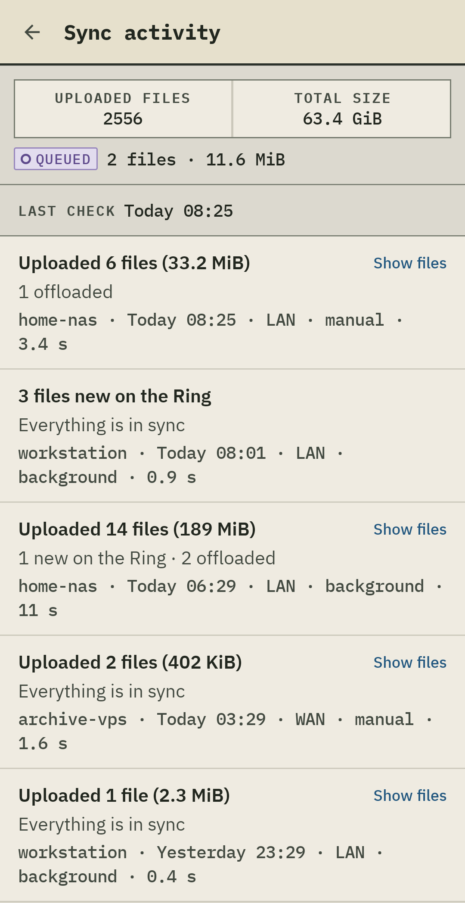<br /><sub>Sync activity · Light</sub></td>
  </tr>
  <tr>
    <td align="center">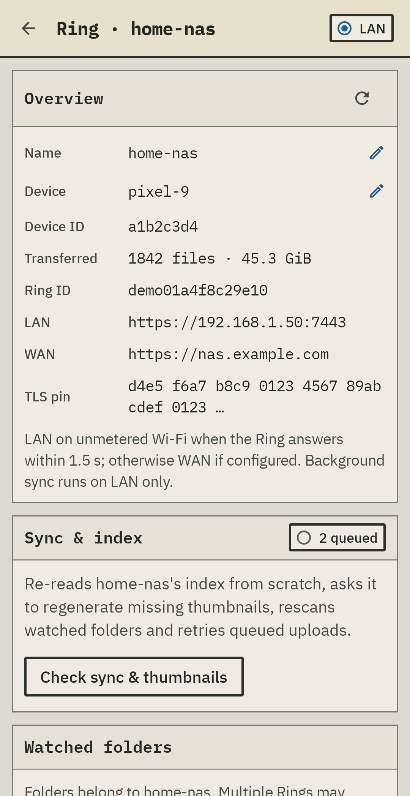<br /><sub>Ring settings · Light</sub></td>
    <td align="center">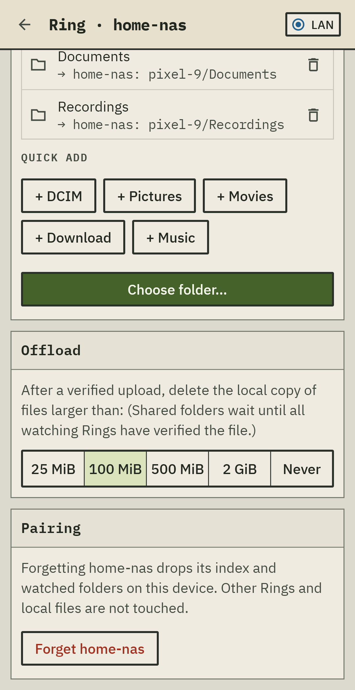<br /><sub>Watched folders · Light</sub></td>
    <td align="center">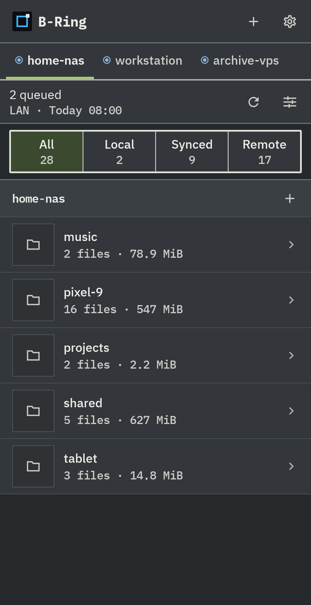<br /><sub>Home · Dark</sub></td>
    <td align="center">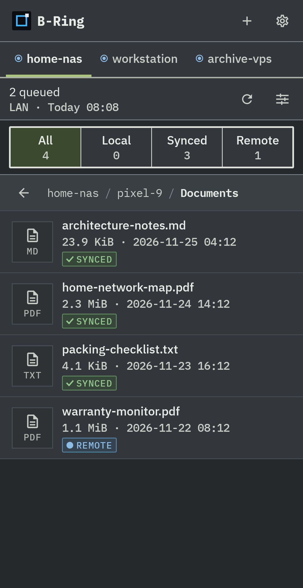<br /><sub>Documents · Dark</sub></td>
  </tr>
  <tr>
    <td align="center">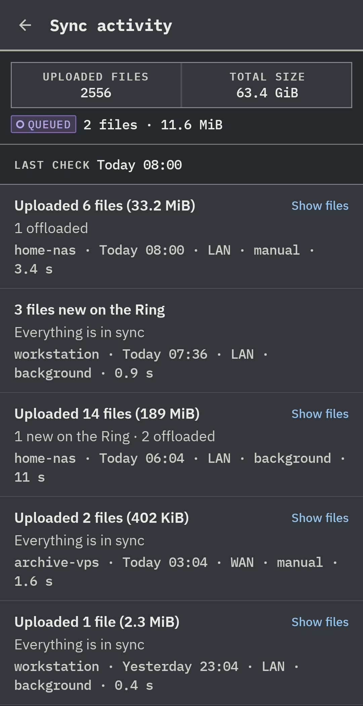<br /><sub>Sync activity · Dark</sub></td>
    <td align="center">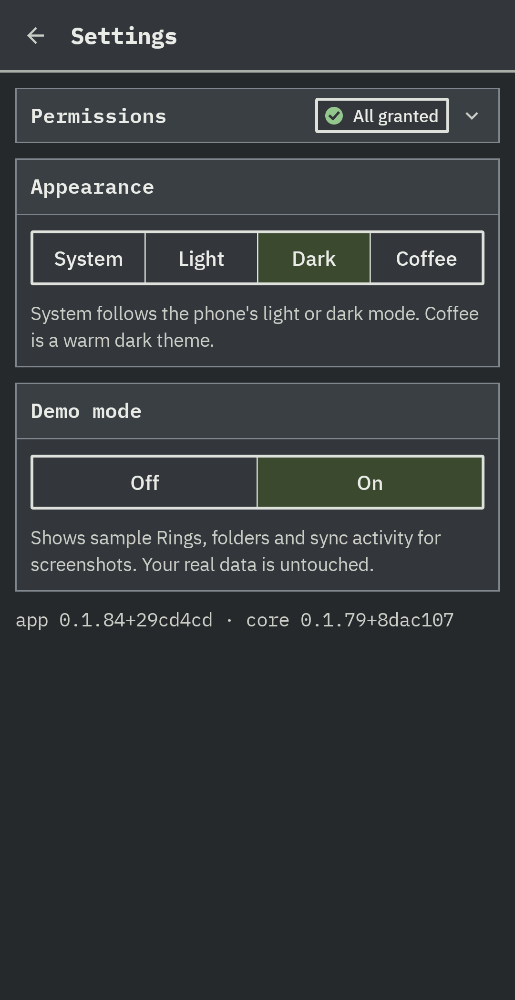<br /><sub>Settings · Dark</sub></td>
    <td align="center">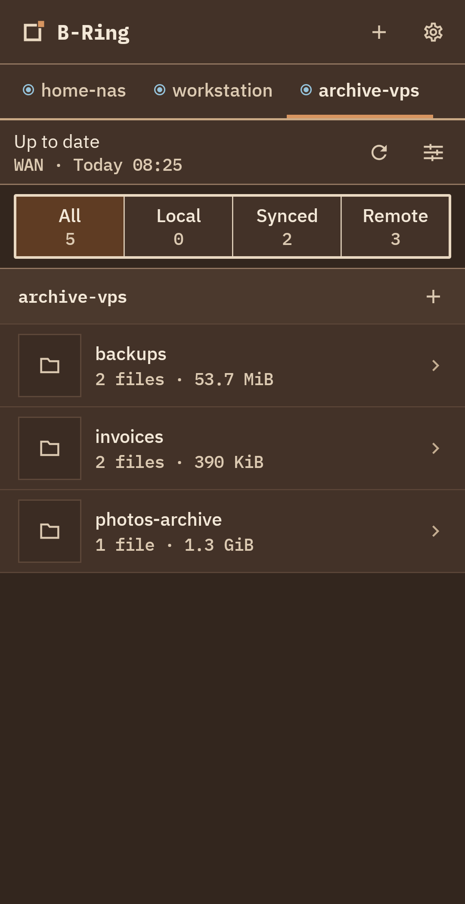<br /><sub>Home · Coffee</sub></td>
    <td align="center">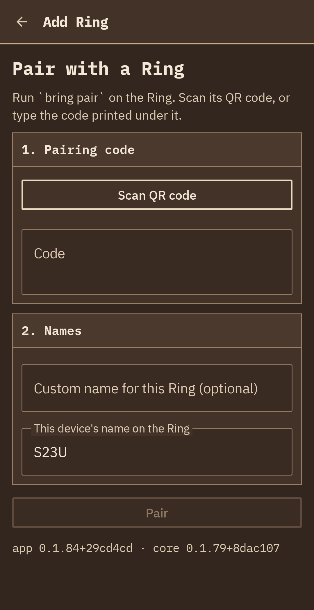<br /><sub>Pair Ring · Coffee</sub></td>
  </tr>
</table>

## Running the Ring

```sh
cargo install --path crates/bringd --locked
cargo install --path crates/bring-cli --locked
install -Dm644 dist/systemd/bringd.service ~/.config/systemd/user/bringd.service
systemctl --user daemon-reload
systemctl --user enable --now bringd
loginctl enable-linger "$USER"      # optional: keep running without a login

bring status
bring pair                          # QR code + code for manual entry
bring pair --sound --ble            # …also play it as sound and offer it over Bluetooth LE
bring pair --sound --sound-band high  # …as near-ultrasound (18–21 kHz, inaudible to most adults)
bring devices
bring rename <slug|id> <name>
bring revoke <slug|id>

# Later updates (rebuilds bringd + bring, updates unit, restarts safely):
./dist/update-ring.sh --pull
```

`bringd` works without a config file. To change defaults, create
`~/.config/bring/bringd.toml`:

```toml
ring_root   = "~/B-Ring"                 # plain files live here
data_dir    = "~/.local/share/bring"     # index, thumbnails, TLS identity
lan_listen  = "0.0.0.0:7443"             # HTTPS (self-signed, pinned by Moons)
# proxy_listen = "127.0.0.1:7480"        # plain HTTP for a TLS reverse proxy
# wan_url      = "https://files.example.org"
# advertise_ip = "192.168.1.10"          # LAN IP put into pairing codes
# folders     = ["DCIM", "Download", "Inbox"] # optional folders to pre-create on start (empty by default)
debounce_ms = 2000                       # quiet time before a change is indexed
ffmpeg      = "ffmpeg"                   # video/HEIC thumbnails (optional)
notifications = false                    # desktop notifications on uploads (off by default)
pairing_ttl_secs = 300
min_free_percent = 5                     # refuse uploads below N% free disk space (1..=99)
```

## Development

```sh
cargo test --workspace
# Manual smoke test of the real binary (shows a desktop notification):
cargo test -p bringd --test smoke -- --ignored --nocapture
```

## Android app

Target devices are all `arm64-v8a`. One-time setup (Android command-line
tools in `~/Android/Sdk`, or set `ANDROID_HOME` / `android/local.properties`):

```sh
sdkmanager "ndk;30.0.16248370" "platforms;android-37.2" "build-tools;37.0.0" "platform-tools"
rustup target add aarch64-linux-android
cargo install cargo-ndk --locked
```

Build, test and install (Gradle builds the Rust engine through
`android/build-rust.sh` first):

```sh
cd android
./gradlew testDebugUnitTest assembleDebug
adb install -r app/build/outputs/apk/debug/app-debug.apk
```

The APK is arm64-v8a only. To also run it in an x86_64 emulator (needs
`rustup target add x86_64-linux-android`):

```sh
./gradlew -Pbring.abis=arm64-v8a,x86_64 assembleDebug
```

`android/build-rust.sh` can also be run on its own (`--debug` for an
unoptimized build). Its outputs are generated and gitignored:
`app/src/main/jniLibs/arm64-v8a/libbring_uniffi.so` and the Kotlin bindings
in `app/src/generated/kotlin/`.

First run: pair with `bring pair` (scan the QR code or type the code), then
grant all-files access and pick the folders to back up in Settings.
